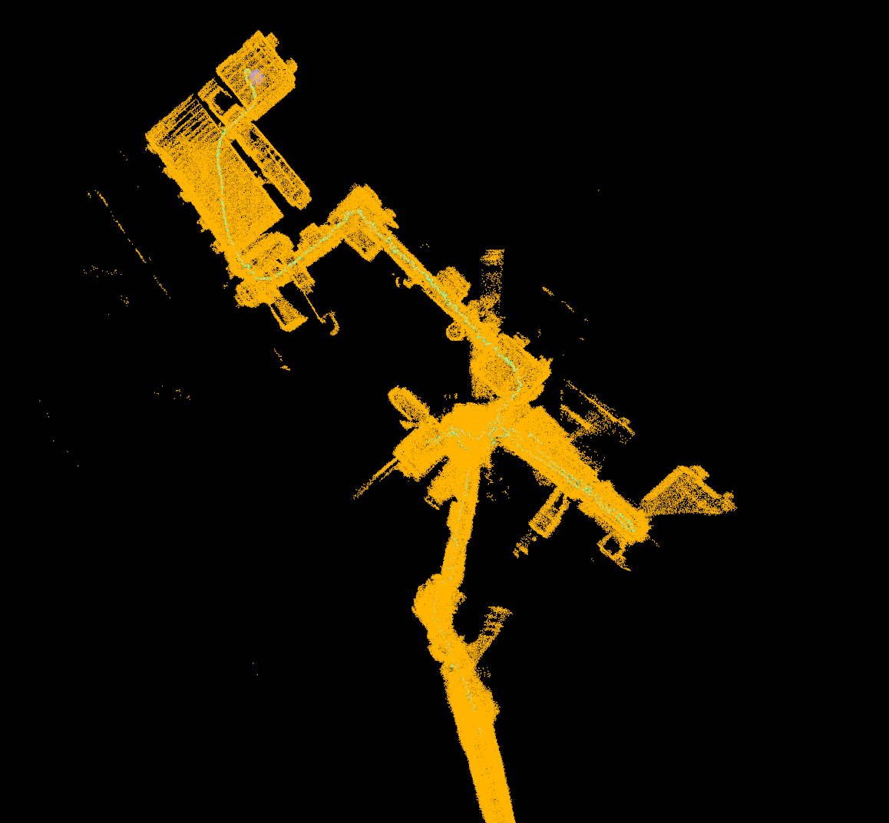
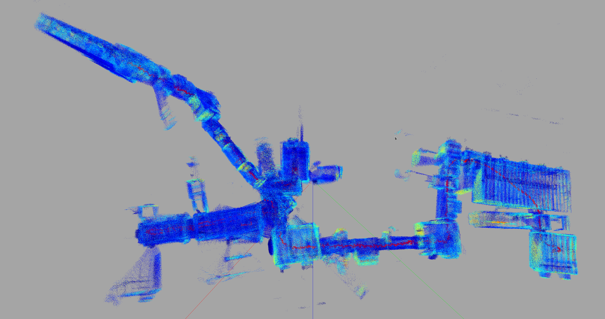

# KISS-SLAM to HDMapping simplified instruction

**Note:** KISS-SLAM is a LiDAR-only SLAM (no IMU). It runs offline on the CPU:
it reads the bag itself, as fast as it processes the scans, so a run can take
longer than the bag but never drops a scan. You watch it in its own Open3D
viewer instead of RViz.

## Step 1 (prepare data)
Download the dataset `reg-1.bag` by clicking [link](https://cloud.cylab.be/public.php/dav/files/7PgyjbM2CBcakN5/reg-1.bag) or from the [Zenodo](https://zenodo.org/records/23069933) mirror (it is part of [Bunker DVI Dataset](https://charleshamesse.github.io/bunker-dvi-dataset)).

On Zenodo the bag archive is split into `reg-1.zip.part-000`, `reg-1.zip.part-001`, etc.,
download all parts, then merge and extract them:

```bash
cd ~/Downloads
cat reg-1.zip.part-0* > full.zip
zip -F full.zip --out full-fixed.zip
unzip full-fixed.zip
```

File `reg-1.bag` should be located in `~/hdmapping-benchmark/data`.

KISS-SLAM reads `sensor_msgs/PointCloud2` only, so convert the Livox LiDAR
messages of `reg-1.bag` with [livox_bag_aggregate](https://github.com/MapsHD/livox_bag_aggregate):

```shell
mkdir -p ~/hdmapping-benchmark
cd ~/hdmapping-benchmark
git clone https://github.com/MapsHD/livox_bag_aggregate.git --recursive
cd ~/hdmapping-benchmark/livox_bag_aggregate
docker build -t livox_bag_aggregate_noetic .
chmod +x livox_bag.sh
./livox_bag.sh ~/hdmapping-benchmark/data/reg-1.bag ~/hdmapping-benchmark/data
```

File `reg-1.bag-pc.bag` is an input for further calculations.
It should be located in `~/hdmapping-benchmark/data`.

## Step 2 (prepare docker)
```shell
mkdir -p ~/hdmapping-benchmark
cd ~/hdmapping-benchmark
git clone https://github.com/MapsHD/benchmark-KISS-SLAM-to-HDMapping.git --recursive
cd benchmark-KISS-SLAM-to-HDMapping
git checkout Bunker-DVI-Dataset-reg-1
docker build -t kiss-slam_standalone .
```

## Step 3 (run docker, file `reg-1.bag-pc.bag` should be in `~/hdmapping-benchmark/data`)
```shell
cd ~/hdmapping-benchmark/benchmark-KISS-SLAM-to-HDMapping
chmod +x docker_session_run-kiss-slam.sh
cd ~/hdmapping-benchmark/data
~/hdmapping-benchmark/benchmark-KISS-SLAM-to-HDMapping/docker_session_run-kiss-slam.sh reg-1.bag-pc.bag .
```

While the bag is processed you can watch KISS-SLAM build the map live in its
viewer: yellow is the current local map, green the pose of every scan, blue the
key poses of the local maps. Rotate with the left mouse button, pan with
Ctrl + left button, zoom with the wheel; `C` fits the view to everything drawn,
`SPACE` pauses. `ESC` and `Q` are disabled, so the run cannot be interrupted
from the viewer; to run without it, put `VIS=0` in front of the command. The
viewer uses the GPU when one is found, otherwise the CPU (slower).



## Step 4 (Open and visualize data)
Expected data should appear in `~/hdmapping-benchmark/data/output_hdmapping-kiss-slam`.
Use tool [multi_view_tls_registration_step_2](https://github.com/MapsHD/HDMapping) to open `session.json` from `~/hdmapping-benchmark/data/output_hdmapping-kiss-slam`.



You should see the following data in folder `~/hdmapping-benchmark/data/output_hdmapping-kiss-slam`:

lio_initial_poses.reg

poses.reg

scan_lio_*.laz

session.json

trajectory_lio_*.csv

## Contact email
januszbedkowski@gmail.com
